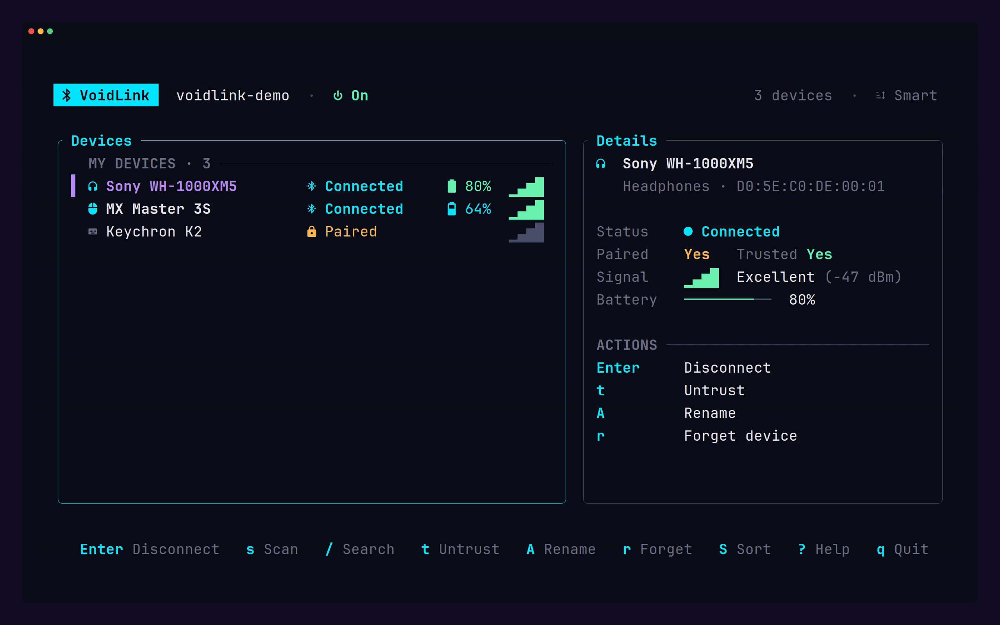
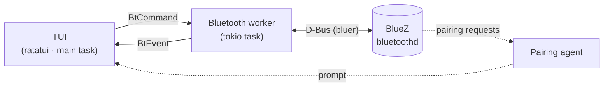

<div align="center">


# VoidLink

**Bluetooth, without leaving your terminal.**

A fast, keyboard-first Bluetooth manager for Linux. Scan, pair, connect and manage<br>
your devices in a clean terminal UI that talks to BlueZ directly over D-Bus.

[](https://aur.archlinux.org/packages/voidlink)
[](https://aur.archlinux.org/packages/voidlink-bin)
[](https://github.com/CPT-Dawn/VoidLink/releases/latest)
[](https://github.com/CPT-Dawn/VoidLink/actions/workflows/ci.yml)
[](LICENSE)

[Install](#-install) · [Quick start](#-quick-start) · [Keys](#%EF%B8%8F-keybindings) · [Configuration](#-configuration) · [Troubleshooting](#-troubleshooting)

<br>



<sub>Recorded at 2560×1440 · <a href="assets/demo.mp4">watch the full-quality video</a></sub>

</div>

<br>

## ✨ Why VoidLink

|  |  |
| --- | --- |
| ⚡ **Instant and light** | One small native binary. No polling, no `bluetoothctl` subprocesses, and zero CPU while idle. |
| 🔐 **Safe pairing** | Every pairing request asks you first: confirm the code, allow or deny, or type the PIN. Nothing is accepted behind your back. |
| 🔄 **Always current** | Connection state, battery and signal update live, including changes made by other apps or by the device itself. |
| ⌨️ **Keyboard-first, mouse-friendly** | Vim-style keys you can remap, plus click, double-click and scroll. |
| 🧭 **Friendly by design** | Clear empty states, plain-English errors with the fix included, and a help screen one key away. |
| 🎨 **Looks right everywhere** | A transparent-friendly theme you can recolour, Nerd Font icons with a plain-Unicode fallback, and a layout that adapts down to 44×12. |

## 📦 Install

### Arch Linux (AUR)

```bash
paru -S voidlink-bin    # prebuilt binary, installs in seconds
# or
paru -S voidlink        # build from source
```

(`yay -S …` works the same way.)

### Any Linux distribution (prebuilt binary)

Download the archive for your CPU (`x86_64` or `aarch64`) from the
[latest release](https://github.com/CPT-Dawn/VoidLink/releases/latest), then:

```bash
tar -xzf voidlink-*-linux.tar.gz
sudo install -Dm755 voidlink-*-linux/voidlink /usr/local/bin/voidlink
```

Every archive ships with a `.sha256` checksum next to it.

### From source

```bash
# Needs Rust 1.88+ plus the D-Bus headers (libdbus-1-dev / dbus-devel / dbus)
cargo install --locked --git https://github.com/CPT-Dawn/VoidLink
```

### Requirements

| What | Why | Arch | Debian / Ubuntu | Fedora |
| --- | --- | --- | --- | --- |
| **BlueZ** + running service | The Bluetooth stack VoidLink drives | `bluez` | `bluez` | `bluez` |
| **D-Bus** | How VoidLink talks to BlueZ | `dbus` | `dbus` | `dbus` |
| Nerd Font *(optional)* | Device and status icons | `ttf-nerd-fonts-symbols-mono` | [nerdfonts.com](https://www.nerdfonts.com) | [nerdfonts.com](https://www.nerdfonts.com) |
| Bluetooth audio *(optional)* | Headphones and speakers | `pipewire-audio` | `libspa-0.2-bluetooth` | included with PipeWire |

Then enable the Bluetooth service once:

```bash
sudo systemctl enable --now bluetooth.service
```

No Nerd Font? Run `voidlink --no-nerd-font`, or set `nerd_font = false` in the config.

## 🚀 Quick start

```bash
voidlink
```

1. Press <kbd>s</kbd> to scan. Nearby devices appear under **Nearby**.
2. Put your device in pairing mode, select it and press <kbd>Enter</kbd>.
3. If a code appears, check it matches the device and press <kbd>y</kbd>.

That's it. VoidLink pairs, trusts and connects in one step, and the device
moves to **My devices** for next time. Press <kbd>?</kbd> at any time for every key.

## ⌨️ Keybindings

| Key | Action | | Key | Action |
| --- | --- | --- | --- | --- |
| <kbd>j</kbd> <kbd>k</kbd> / <kbd>↑</kbd> <kbd>↓</kbd> | Move | | <kbd>Enter</kbd> | Connect / disconnect (pairs if needed) |
| <kbd>g</kbd> <kbd>G</kbd> | Top / bottom | | <kbd>p</kbd> | Pair only |
| <kbd>/</kbd> | Search (start with `/` for regex) | | <kbd>t</kbd> | Trust / untrust (auto-reconnect) |
| <kbd>S</kbd> | Sort: smart, name, signal, address | | <kbd>A</kbd> | Rename |
| <kbd>s</kbd> | Start / stop scanning | | <kbd>r</kbd> | Forget (asks first) |
| <kbd>a</kbd> | Turn Bluetooth on / off | | <kbd>d</kbd> | Disconnect |
| <kbd>?</kbd> | Help | | <kbd>R</kbd> | Refresh device |
| <kbd>Esc</kbd> | Clear search / dismiss | | <kbd>q</kbd> / <kbd>Ctrl</kbd>+<kbd>C</kbd> | Quit |

**Mouse:** click to select, double-click to connect, scroll to move. All keys can be remapped.

## 🔧 Configuration

VoidLink creates `~/.config/voidlink/config.toml` on first launch. Every key is
optional, and anything invalid is reported in the app and replaced by its default.

```toml
[general]
scan_on_startup = false
hide_unnamed_devices = false   # hide anonymous BLE beacons
sort_mode = "default"          # default | name | rssi | address
nerd_font = true               # false = plain Unicode symbols
mouse = true                   # false = keep terminal text selection

[bluetooth]
auto_trust_on_pair = true      # trusted devices reconnect on their own
connection_timeout_secs = 30

[theme.palette]                # "#RRGGBB"; backgrounds stay transparent
accent_primary = "#00E5FF"
accent_secondary = "#BB86FC"

[keybindings]
connect_toggle = "Enter"
toggle_scan = "s"
```

See every option with `voidlink --print-default-config`, or browse
[`default_config.toml`](default_config.toml).

<details>
<summary><b>Command-line options</b></summary>

```text
voidlink [OPTIONS]

    --no-nerd-font          Use plain Unicode symbols instead of Nerd Font icons
    --no-mouse              Don't capture the mouse (keeps terminal text selection)
    --print-default-config  Print the default config.toml and exit
    --config-path           Print where the config file lives and exit
    -h, --help              Show help and exit
    -V, --version           Show the version and exit
```

</details>

## 🩺 Troubleshooting

<details>
<summary><b>"The Bluetooth service isn't running"</b></summary>

Install BlueZ and start it: `sudo systemctl enable --now bluetooth.service`.
VoidLink reconnects by itself as soon as the service is up.
</details>

<details>
<summary><b>"Bluetooth is blocked by rfkill"</b></summary>

Your laptop's wireless switch or a software block is on. Run `rfkill unblock bluetooth`
(check with `rfkill list`).
</details>

<details>
<summary><b>Headphones pair but won't connect ("No audio profile is available")</b></summary>

Your audio server is missing Bluetooth support. On Arch install `pipewire-audio`
(or `pulseaudio-bluetooth` with PulseAudio), then restart your session or run
`systemctl --user restart pipewire wireplumber`.
</details>

<details>
<summary><b>I see boxes or question marks instead of icons</b></summary>

Your terminal font has no Nerd Font glyphs. Install one (for example
`ttf-nerd-fonts-symbols-mono`) or run `voidlink --no-nerd-font`.
</details>

<details>
<summary><b>I can't select text in my terminal while VoidLink is open</b></summary>

VoidLink captures the mouse. Hold <kbd>Shift</kbd> while selecting, or turn it off with
`--no-mouse` / `mouse = false`.
</details>

<details>
<summary><b>Something else went wrong</b></summary>

Run `VOIDLINK_LOG=debug voidlink`, reproduce the problem, and attach
`~/.local/state/voidlink/voidlink.log` to an
[issue](https://github.com/CPT-Dawn/VoidLink/issues/new).
</details>

## 🧠 How it works



The interface never touches D-Bus and the worker never touches the terminal.
Slow operations such as connecting run as their own tasks, and per-device property
streams keep the screen current without polling. The UI only redraws when
something changes.

## 🤝 Contributing

Issues and pull requests are welcome.

```bash
cargo test --features demo         # unit + render tests
cargo clippy --all-targets -- -D warnings
VOIDLINK_DEMO=1 cargo run --features demo   # fake devices, no hardware needed
```

The demo above is generated from [`demo/voidlink.tape`](demo/voidlink.tape) with
[VHS](https://github.com/charmbracelet/vhs) and the built-in demo adapter, so it
shows no real devices.

## 📄 License

[MIT](LICENSE) © Swastik Patel ([CPT-Dawn](https://github.com/CPT-Dawn))
