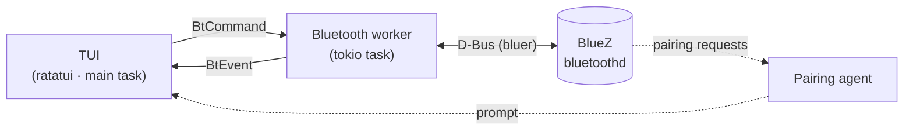

# Architecture

How VoidLink is put together: the terminal UI, the Bluetooth worker, and the BlueZ daemon they drive.

## The two halves

| Part | Lives in | Owns |
| --- | --- | --- |
| UI | [`src/main.rs`](../src/main.rs), [`src/app.rs`](../src/app.rs), [`src/ui/`](../src/ui) | The terminal, the `App` state, keyboard and mouse input |
| Bluetooth worker | [`src/bluetooth/worker.rs`](../src/bluetooth/worker.rs) | The `bluer` session and adapter, every D-Bus call |
| Pairing agent | [`src/bluetooth/agent.rs`](../src/bluetooth/agent.rs) | BlueZ pairing requests, forwarded to the UI as prompts |

The UI never touches D-Bus and the worker never touches the terminal. They talk over two channels: `BtCommand` from the UI, `BtEvent` back (both in [`src/bluetooth/types.rs`](../src/bluetooth/types.rs)). Devices cross as plain `DeviceInfo` snapshots, so no D-Bus handle reaches the UI.

## Staying current without polling

- Per-device property streams from BlueZ push connection, battery and signal changes as they happen, including changes made by other tools.
- Slow operations such as connecting run as their own tasks, so the list stays responsive.
- The UI redraws only when its state is marked dirty. The animation tick runs only while a spinner or toast is moving ([`src/event.rs`](../src/event.rs)).
- When `bluetoothd` restarts or the adapter disappears, the worker recovers by itself.

## Pairing

Every request BlueZ sends the agent becomes a prompt: confirm a code, allow or deny, or type a PIN. Nothing is accepted on your behalf, and a prompt left unanswered for 24 seconds is rejected.

## Demo mode

Built with `--features demo` and run with `VOIDLINK_DEMO=1`, VoidLink swaps the worker for a scripted fake adapter ([`src/bluetooth/demo.rs`](../src/bluetooth/demo.rs)). Release and AUR builds don't include it.

[Back to the README](../README.md)
